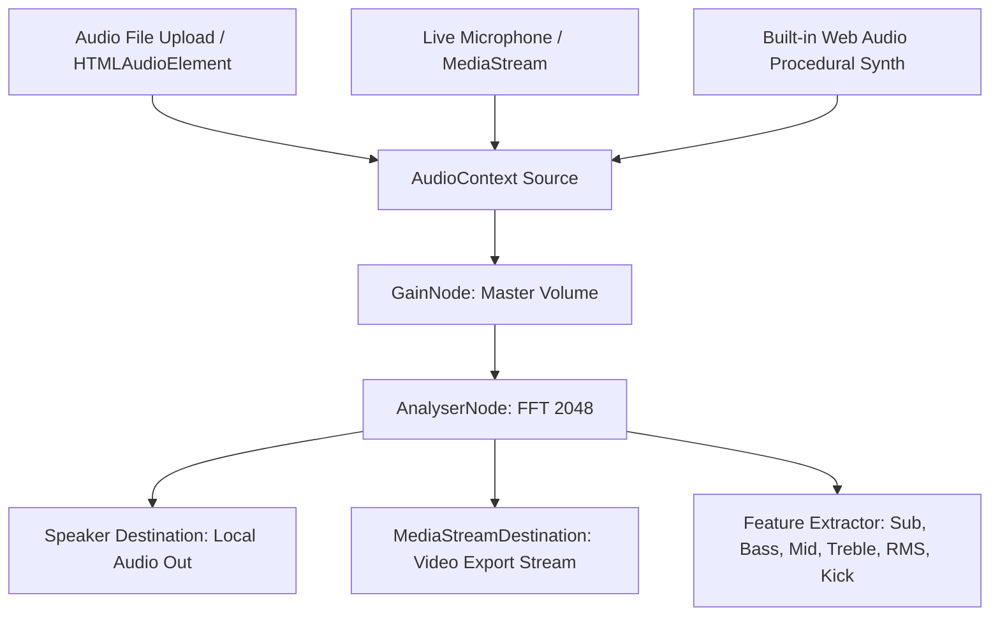

# Web Audio Pipeline Skill

Use this skill to build, calibrate, and troubleshoot the audio analysis engine in Visuval.

## Audio Engine Architecture



## Multi-Band Frequency Calculation

Given an `AnalyserNode` with `fftSize = 2048` and sample rate $44100\text{ Hz}$, each bin represents:
$$\Delta f = \frac{44100}{2048} \approx 21.53\text{ Hz}$$

Frequency band mapping:
* **Sub-Bass (20 - 60 Hz)** : Bins 1 to 3
* **Bass (60 - 250 Hz)** : Bins 3 to 12
* **Low-Mid (250 - 1000 Hz)** : Bins 12 to 46
* **Mid-Range (1000 - 4000 Hz)** : Bins 46 to 186
* **Treble (4000 - 16000 Hz)** : Bins 186 to 743

```typescript
export function computeBandEnergy(freqData: Uint8Array, startBin: number, endBin: number): number {
  let sum = 0;
  const count = Math.max(1, endBin - startBin);
  for (let i = startBin; i < endBin && i < freqData.length; i++) {
    sum += freqData[i];
  }
  return (sum / count) / 255.0; // Normalized 0.0 to 1.0
}
```

## Transient Beat Detection (Kick Detection)

A robust, low-latency beat detector using local energy history and dynamic variance:

```typescript
export class BeatDetector {
  private history: number[] = new Array(40).fill(0);
  private historyIndex = 0;
  public beatEnergy = 0;
  public isBeat = false;

  update(bassEnergy: number, decay: number = 0.92): boolean {
    // 1. Calculate average energy over the last 40 frames (~0.67s at 60fps)
    let sum = 0;
    for (let i = 0; i < this.history.length; i++) {
      sum += this.history[i];
    }
    const avg = sum / this.history.length;

    // 2. Calculate variance
    let variance = 0;
    for (let i = 0; i < this.history.length; i++) {
      variance += Math.pow(this.history[i] - avg, 2);
    }
    variance /= this.history.length;

    // 3. Dynamic sensitivity constant
    const sensitivity = -15 * variance + 1.45;
    const threshold = avg * Math.max(1.15, Math.min(1.8, sensitivity));

    // 4. Trigger kick
    if (bassEnergy > threshold && bassEnergy > 0.35 && this.beatEnergy < 0.2) {
      this.isBeat = true;
      this.beatEnergy = 1.0;
    } else {
      this.isBeat = false;
      this.beatEnergy *= decay;
    }

    this.history[this.historyIndex] = bassEnergy;
    this.historyIndex = (this.historyIndex + 1) % this.history.length;

    return this.isBeat;
  }
}
```

## Built-in Procedural Synth (Zero-Asset Demo Audio)

Generates an audio-reactive electronic synth loop without needing any external audio file:

```typescript
export class DemoSynth {
  private isRunning = false;
  private intervalId: any = null;

  constructor(private ctx: AudioContext, private destinationNode: AudioNode) {}

  start() {
    if (this.isRunning) return;
    this.isRunning = true;
    let step = 0;
    const notes = [130.81, 146.83, 164.81, 196.00, 220.00, 261.63, 293.66, 329.63]; // C Pentatonic

    this.intervalId = setInterval(() => {
      const time = this.ctx.currentTime;
      // Kick on quarter notes
      if (step % 4 === 0) {
        this.playKick(time);
      }
      // Synth arpeggio on 16th notes
      const freq = notes[step % notes.length];
      this.playPluck(freq, time);
      step = (step + 1) % 16;
    }, 125); // 120 BPM 16th notes
  }

  private playKick(t: number) {
    const osc = this.ctx.createOscillator();
    const gain = this.ctx.createGain();
    osc.frequency.setValueAtTime(150, t);
    osc.frequency.exponentialRampToValueAtTime(30, t + 0.12);
    gain.gain.setValueAtTime(1.0, t);
    gain.gain.exponentialRampToValueAtTime(0.001, t + 0.25);
    osc.connect(gain);
    gain.connect(this.destinationNode);
    osc.start(t);
    osc.stop(t + 0.25);
  }

  private playPluck(freq: number, t: number) {
    const osc = this.ctx.createOscillator();
    const gain = this.ctx.createGain();
    osc.type = 'sawtooth';
    osc.frequency.setValueAtTime(freq, t);
    gain.gain.setValueAtTime(0.25, t);
    gain.gain.exponentialRampToValueAtTime(0.001, t + 0.18);
    osc.connect(gain);
    gain.connect(this.destinationNode);
    osc.start(t);
    osc.stop(t + 0.18);
  }

  stop() {
    this.isRunning = false;
    if (this.intervalId) clearInterval(this.intervalId);
  }
}
```
