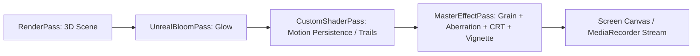

# Shader FX & Post-Processing Skill

Use this skill to create, configure, and optimize post-processing passes and custom GLSL fragment shaders for Visuval.

## Post-Processing Architecture

Visuval uses Three.js `EffectComposer` with a chain of optimized rendering passes:



Combining multiple screen effects (Vignette, Grain, Aberration, CRT) into a **single Master Uber-Shader** saves multiple render target switches and texture fetches, guaranteeing stable 60 FPS even on integrated GPUs.

## Master Screen Shader (GLSL)

```glsl
// masterScreenShader.glsl
uniform sampler2D tDiffuse;
uniform float uTime;
uniform float uVignette;
uniform float uFilmGrain;
uniform float uChromaticAberration;
uniform float uScanlines;
uniform float uCrtBend;
uniform float uAudioBass;
varying vec2 vUv;

// Fast pseudo-random generator
float random(vec2 p) {
    return fract(sin(dot(p, vec2(12.9898, 78.233))) * 43758.5453);
}

// CRT Barrel Distortion
vec2 crtDistort(vec2 uv, float bend) {
    if (bend <= 0.0) return uv;
    vec2 cc = uv - 0.5;
    float dist = dot(cc, cc);
    return uv + cc * (dist * bend);
}

void main() {
    // 1. CRT Screen Bend
    vec2 uv = crtDistort(vUv, uCrtBend);
    if (uv.x < 0.0 || uv.x > 1.0 || uv.y < 0.0 || uv.y > 1.0) {
        gl_FragColor = vec4(0.0, 0.0, 0.0, 1.0);
        return;
    }

    // 2. Chromatic Aberration (RGB Split)
    float split = uChromaticAberration * (0.005 + uAudioBass * 0.015);
    vec2 dir = uv - 0.5;
    float r = texture2D(tDiffuse, uv + dir * split).r;
    float g = texture2D(tDiffuse, uv).g;
    float b = texture2D(tDiffuse, uv - dir * split).b;
    vec3 color = vec3(r, g, b);

    // 3. CRT Scanlines
    if (uScanlines > 0.0) {
        float scanline = sin(uv.y * 800.0) * 0.5 + 0.5;
        color *= 1.0 - (scanline * uScanlines * 0.3);
    }

    // 4. Vignette
    if (uVignette > 0.0) {
        float dist = distance(uv, vec2(0.5));
        float vig = smoothstep(0.8, 0.2, dist * (1.0 + uVignette));
        color *= vig;
    }

    // 5. Film Grain
    if (uFilmGrain > 0.0) {
        float noise = (random(uv + vec2(uTime * 15.0, uTime * 23.0)) - 0.5) * uFilmGrain;
        color += noise;
    }

    gl_FragColor = vec4(color, 1.0);
}
```

## Configuring UnrealBloomPass for Neon Glow

```typescript
import { UnrealBloomPass } from 'three/examples/jsm/postprocessing/UnrealBloomPass.js';
import * as THREE from 'three';

export function setupBloom(width: number, height: number): UnrealBloomPass {
  const bloomPass = new UnrealBloomPass(
    new THREE.Vector2(width, height),
    1.2,   // strength (0.0 - 3.0)
    0.4,   // radius
    0.2    // threshold (only bright elements glow)
  );
  return bloomPass;
}
```

## Dynamic Camera Shake on Kick Hit

```typescript
export class CameraRig {
  private basePosition = new THREE.Vector3(0, 0, 10);
  private shakeOffset = new THREE.Vector3();
  private shakeDecay = 0.9;

  triggerKick(intensity: number = 0.5) {
    this.shakeOffset.set(
      (Math.random() - 0.5) * intensity,
      (Math.random() - 0.5) * intensity,
      (Math.random() - 0.5) * (intensity * 0.5)
    );
  }

  update(camera: THREE.Camera) {
    this.shakeOffset.multiplyScalar(this.shakeDecay);
    camera.position.copy(this.basePosition).add(this.shakeOffset);
  }
}
```
