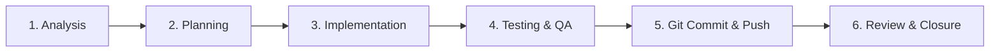

# Visualizor Ticket Lifecycle Procedure (A to Z)

Follow this rigorous 6-step lifecycle for every ticket, bug report, or feature request in Visualizor:



---

## Step 1: Requirement Analysis
* Identify whether the request is a **Feature**, **Bug Fix**, **Performance Optimization**, or **New Preset**.
* Check dependencies across the Audio Engine, Three.js Rendering Engine, Post-processing Shaders, or UI Dock/Rail.
* Define clear acceptance criteria before modifying code.

## Step 2: Technical Planning
* Identify the exact files requiring edits or creation:
  - Presets: `src/presets/<Name>.ts` and export in `src/presets/index.ts`.
  - Audio processing: `src/audio/AudioEngine.ts`.
  - Shaders / Post-processing: `src/engine/RenderEngine.ts`.
  - UI / Controls: `src/ui/` or `index.html`.
* Ensure proposed changes respect the **Zero-Allocation 60 FPS** rule.

## Step 3: Clean Implementation
* Implement code in TypeScript with strict typing.
* Use `InstancedMesh` for multiple objects and vertex shaders for GPU displacements.
* Ensure all geometries and materials have corresponding `.dispose()` calls.

## Step 4: Automated Testing & Verification
* Run static typechecking:
  ```powershell
  $env:Path = "C:\Program Files\nodejs;" + $env:Path
  npx tsc --noEmit
  ```
* Run production bundle build:
  ```powershell
  $env:Path = "C:\Program Files\nodejs;" + $env:Path
  npm run build
  ```
* Test in browser for:
  - 60 FPS rendering without lag spikes.
  - Correct audio-reactivity on bass, mid, treble, and kick hits.
  - Smooth theme switching.

## Step 5: Git Commit & GitHub Push
* Stage only the relevant files:
  ```powershell
  git add <modified-files>
  ```
* Commit using Conventional Commits format:
  ```powershell
  git commit -m "<type>(<scope>): <clear description>"
  ```
* Push to the remote repository.

## Step 6: Ticket Closure
* Summarize changes made, files touched, and test results.
* Update documentation or preset catalog if new capabilities were introduced.
